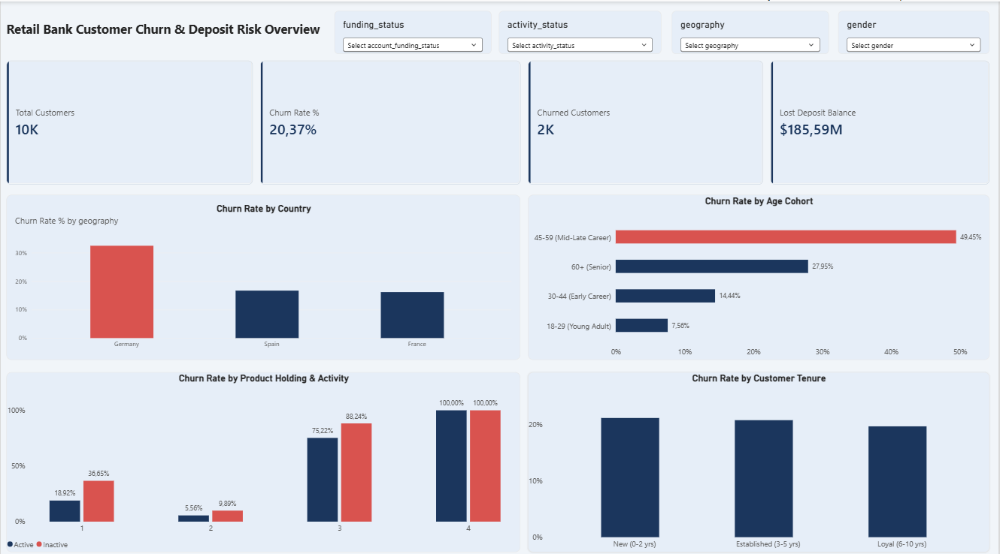
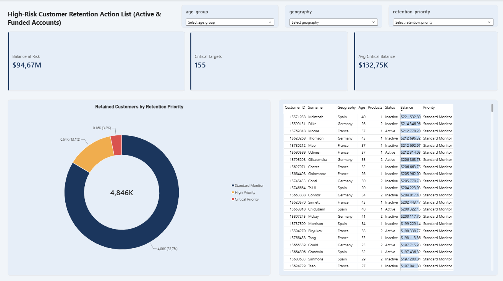

# Retail Bank Customer Churn & Deposit Risk Analytics

[](https://www.python.org/)
[](https://www.mysql.com/)
[](https://powerbi.microsoft.com/)

An end-to-end retail banking analytics pipeline engineered to diagnose customer attrition drivers, quantify deposit balances at risk, and generate a prioritized outreach list for customer retention teams.

---

## Executive Summary & Business Problem

A retail bank faces a **20.37% customer attrition rate**, resulting in **$185.59M in lost deposit balances** across 2,037 churned accounts. Because retail deposits directly fund lending operations and net interest margins, leadership required a repeatable data warehouse and business intelligence solution to:

1. Isolate demographic, geographic, and product-holding segments driving elevated churn.
2. Quantify deposit exposure among currently retained, funded accounts.
3. Deliver an actionable, prioritized retention target list for relationship managers.

---

## System Architecture

```text
┌─────────────────────────────┐
│   Raw Banking Dataset       │  10,000 customer records (CSV)
└──────────────┬──────────────┘
               │  01_etl_pipeline.py (Pandas cleaning, feature engineering, SQLAlchemy)
               ▼
┌─────────────────────────────┐
│   MySQL Staging Layer       │  stg_bank_churn
└──────────────┬──────────────┘
               │  02_star_schema_and_analysis.sql (3NF/Star Schema normalization)
               ▼
┌─────────────────────────────┐
│   MySQL Data Warehouse      │  dim_customers • dim_geography • fact_account_metrics
└──────────────┬──────────────┘
               │  Semantic Reporting Views (vw_executive_churn, vw_retention_targets)
               ▼
┌─────────────────────────────┐
│   Power BI Executive Report │  Custom DAX Measures & 2-Page Interactive Dashboard
└─────────────────────────────┘
```

---

## Key Analytical Findings

| Risk Dimension | Primary Insight | Business Implication |
|---|---|---|
| **Geography** | Germany exhibits a 32.44% churn rate, nearly double Spain (16.67%) and France (16.15%). | Germany represents the single largest regional leak of high-balance deposits. |
| **Age Cohort** | Customers aged 45–59 experience the sharpest attrition spike at 49.45%, followed by 60+ (27.95%). | Mid-to-late career depositors carry high balances and are most sensitive to competitor rates. |
| **Product & Activity** | Two-product holders show optimal retention (5.56%–9.89% churn), whereas 3–4 product holders spike to 75.22%–100.00%. | Aggressive cross-selling beyond two products introduces fee friction or product mismatch. |
| **Immediate Exposure** | Out of 4,846 retained funded accounts ($94.67M at risk), 155 Critical Priority accounts hold $20.58M (avg. $132.75K). | Targeted outreach to a small, high-value cohort can protect millions in deposit capital. |

---

## Quantified Business Recommendations

### 1. Prioritize High-Touch Retention for the 155 Critical-Priority Accounts
- **Action:** Assign dedicated relationship managers to contact the 155 retained customers aged 45+ who are currently inactive and hold >$100K in deposits, offering tailored rate reviews or fee waivers.
- **Projected Impact:** Retaining 15%–20% of this segment preserves **$3.1M–$4.1M** in high-margin deposit balances.

### 2. Audit 3+ Product Bundles & Fee Structures
- **Action:** Pause automated cross-selling to 2-product customers and review fee structures and product fit for accounts holding 3 or 4 products.
- **Projected Impact:** Reducing 3-product churn from >80% toward the bank baseline (~20%) prevents high-value multi-product relationship breakdowns.

### 3. Deploy Localized Re-Engagement in Germany
- **Action:** Benchmark regional competitor deposit rates in Germany and launch targeted retention incentives for inactive German depositors.
- **Projected Impact:** Closing half the churn gap between Germany (32.44%) and France/Spain (~16.4%) reduces bank-wide churn from 20.37% to **~18.3%**.

---

## Dashboard Previews

**Page 1: Executive Churn Overview**
Tracks overall portfolio health, churn rate, lost deposit volume, and multi-dimensional risk breakdowns across geography, age cohorts, product holdings, and tenure.



**Page 2: Retention Action Targets**
Provides relationship managers with an interactive, balance-sorted outreach list segmented by retention priority (Critical Priority, High Priority, Standard Monitor).



---

## Technical Implementation Details

### Python ETL (`scripts/01_etl_pipeline.py`)
Standardized column schemas, validated null/duplicate integrity, engineered analytical segments (`age_group`, `tenure_group`, `account_funding_status`, `activity_status`), and automated bulk ingestion into MySQL via SQLAlchemy.

### SQL Data Warehouse (`scripts/02_star_schema_and_analysis.sql`)
Modeled a Star Schema separating customer attributes (`dim_customers`) and regional metadata (`dim_geography`) from quantitative metrics (`fact_account_metrics`), exposing pre-aggregated semantic views (`vw_executive_churn` and `vw_retention_targets`) for BI consumption.

### Power BI & DAX (`dashboard/Bank_Churn_Executive_Dashboard.pbix`)
Engineered explicit DAX measures (Total Customers, Churned Customers, Churn Rate %, Lost Deposit Balance, Balance at Risk, Critical Targets, Avg Critical Balance) organized in a dedicated `_Measures` table with conditional outlier highlighting and currency formatting.

---

## Repository Structure

```text
bank-churn-end-to-end-analytics/
├── data/
│   ├── raw_bank_churn.csv
│   └── cleaned_bank_churn.csv
├── scripts/
│   ├── 01_etl_pipeline.py
│   └── 02_star_schema_and_analysis.sql
├── dashboard/
│   ├── Bank_Churn_Executive_Dashboard.pbix
│   ├── page1_overview.png
│   └── page2_retention.png
└── README.md
```

---

## How to Reproduce

1. **Database Setup:** Execute `scripts/02_star_schema_and_analysis.sql` in MySQL Workbench to initialize the `retail_bank_dw` schema and reporting views.
2. **Run ETL Pipeline:** Update your MySQL credentials in `scripts/01_etl_pipeline.py` and run:
   ```bash
   pip install pandas sqlalchemy mysql-connector-python
   python scripts/01_etl_pipeline.py
   ```
3. **Open Dashboard:** Launch `dashboard/Bank_Churn_Executive_Dashboard.pbix` in Power BI Desktop and click **Refresh** to pull live records from MySQL.
